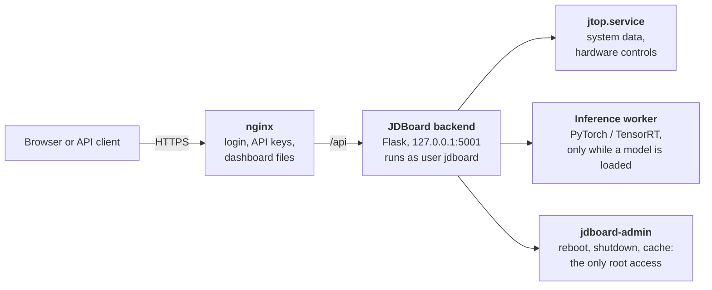

# Introduction

JDBoard is a web dashboard for NVIDIA Jetson devices. It runs on the Jetson and gives
you, in any browser on your network:

- **Monitoring**: CPU, GPU, memory, temperatures, power and fan from
  [jtop](https://github.com/rbonghi/jetson_stats), live; running processes; system and
  inference logs.
- **Hardware controls**: power mode, fan mode, Jetson Clocks, clearing the memory cache,
  reboot and shutdown.
- **Models**: download YOLO models, or upload your own `.pt`, `.onnx` or `.engine` file,
  and convert them to TensorRT on the Jetson.
- **Inference**: run a model on an image and see the results drawn on it: boxes,
  segmentation masks, pose skeletons, oriented boxes and classes.
- **Custom models**: a short Python script adapts any model; it returns shapes that the
  dashboard draws.
- **An HTTP API** for everything, with API keys for bots and scripts.
- **A web terminal**.

## How it fits together

- **nginx** serves the dashboard over HTTPS, checks the login and API keys, and forwards
  `/api` to the backend.
- **The backend** runs as an unprivileged `jdboard` user and only listens on
  `127.0.0.1`, so it can't be reached except through nginx.
- **Models run in a separate worker process** that starts when you load a model and
  stops when you unload it, so JDBoard itself idles at about 100 MB of memory.

## Where to next

- New install: check the [prerequisites](getting-started/prerequisites.md), then
  [install](getting-started/installation.md).
- Already running: see [Using JDBoard](using/dashboard.md).
- Bringing your own model: [Custom inference scripts](custom-models/custom-scripts.md).
- Calling it from code: the [API reference](api/overview.md).
